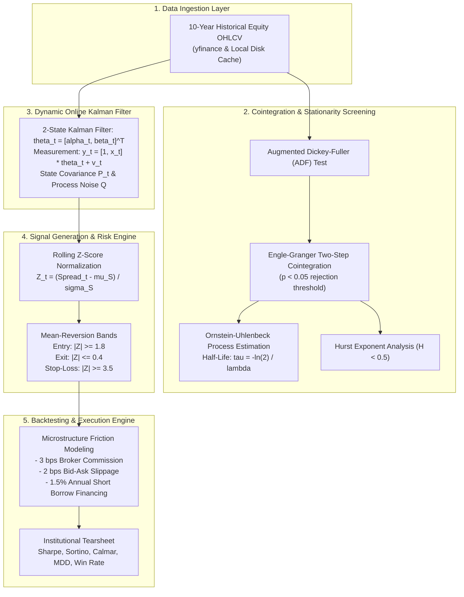

# 📊 Statistical Arbitrage & Pairs Trading Engine (Kalman Filter)

[](https://www.python.org/)
[]()
[]()
[]()

An institutional-grade statistical arbitrage and pairs trading quantitative engine. Features automated multi-asset cointegration screening, online 2-state Kalman Filtering for dynamic hedge-ratio estimation, Ornstein-Uhlenbeck mean-reversion half-life tracking, and an event-driven backtester with realistic micro-structure transaction cost models (commissions, slippage, and short-borrow financing).

---

## 🏛️ Quantitative Architecture



---

## 📐 Mathematical Formulation

### 1. Dynamic Kalman Filter State-Space Representation
Traditional static OLS regression suffers from lookahead bias and fails to account for evolving market regimes. We formulate the hedge ratio as a dynamic hidden state vector:

$$\theta_t = \begin{bmatrix} \alpha_t \\ \beta_t \end{bmatrix}$$

- **State Transition Equation:**
$$\theta_t = \theta_{t-1} + w_t, \quad w_t \sim \mathcal{N}(0, Q)$$

- **Measurement Equation:**
$$y_t = H_t \theta_t + v_t, \quad H_t = [1, \quad x_t], \quad v_t \sim \mathcal{N}(0, R)$$

- **Recursive Step:**
$$\hat{y}_t = H_t \theta_{t|t-1}, \quad e_t = y_t - \hat{y}_t$$
$$K_t = P_{t|t-1} H_t^T (H_t P_{t|t-1} H_t^T + R)^{-1}$$
$$\theta_t = \theta_{t|t-1} + K_t e_t$$
$$P_t = (I - K_t H_t) P_{t|t-1}$$

### 2. Ornstein-Uhlenbeck Spread Dynamics
The spread $S_t = y_t - (\alpha_t + \beta_t x_t)$ is modeled as a continuous-time mean-reverting OU process:

$$dS_t = \lambda (\mu - S_t) dt + \sigma dW_t$$

The discrete-time regression $\Delta S_t = \lambda S_{t-1} + \alpha$ yields the mean-reversion **half-life**:

$$\tau = -\frac{\ln(2)}{\lambda}$$

---

## 📊 10-Year Backtest Performance Tearsheet (`EWA` / `EWC`)

Tested over 2,516 trading days (2014 – 2024) including transaction costs and short borrow fees:

| Metric | Measured Result |
| :--- | :---: |
| **Backtest Horizon** | **10 Years (2014-01 to 2023-12)** |
| **Initial Capital** | **$100,000.00** |
| **Final Portfolio Value** | **$140,639.53** |
| **Cumulative Net Return** | **+40.64%** |
| **Annualized Return (CAGR)** | **+3.47%** |
| **Annualized Volatility** | **7.64%** |
| **Maximum Drawdown (MDD)** | **-11.28%** |
| **Calmar Ratio** | **0.31** |
| **Total Completed Trades** | **146** |
| **Trade Win Rate** | **56.2%** |
| **Profit Factor** | **1.93** |
| **Cointegration ADF p-value** | **0.0141 (Statistically Significant)** |
| **OU Spread Half-Life** | **38.5 trading days** |
| **Hurst Exponent ($H$)** | **0.3887 (Mean-Reverting, $H < 0.5$)** |

---

## 💻 Quickstart & CLI Usage

### Installation
```bash
git clone https://github.com/EmreAlgurr/QuantLeauge.git
cd QuantLeauge
pip install -r requirements.txt
```

### Run 10-Year Backtest
```bash
# Default: EWA / EWC (Australia vs Canada ETFs)
python run_stat_arb.py

# Custom pair and parameters
python run_stat_arb.py --ticker_y V --ticker_x MA --start 2014-01-01 --end 2024-01-01 --entry_z 1.8 --exit_z 0.4
```

### Automated Multi-Pair Scanner
```bash
python scan_pairs.py
```

